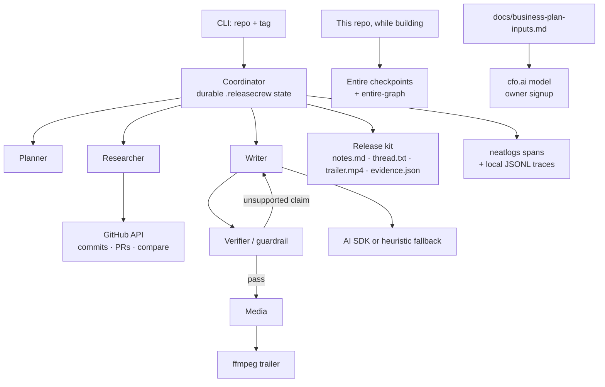

# ReleaseCrew

Give it a GitHub repo and a release tag. A small crew of agents ships the launch story: a **verified** changelog, an X thread, and a short trailer. Invented features get rejected. Failed runs resume.

Built during **neatHack Oct 10–12**.

```bash
npx tsx src/cli.ts --repo honojs/hono --tag v4.13.12 --from v4.13.11 --out examples/hono-v4.13.12
```

Example kit: [`examples/hono-v4.13.12`](./examples/hono-v4.13.12) (Hono `v4.13.11...v4.13.12`).

## Architecture



| Agent | Job |
| --- | --- |
| Coordinator | Runs the crew, writes state after every step, resumes `--resume <id>` |
| Planner | Breaks “ship this tag” into research → write → verify → media → assemble |
| Researcher | Reads releases, compare, commits, merged PRs |
| Writer | Drafts `notes.md` and `thread.txt` from the change list only |
| Verifier | Grounds every bullet in SHAs, PR numbers, files, or official notes |
| Media | Storyboard + PPM slides + ffmpeg. Falls back if the first encoder dies |

Deliberate recoveries, all visible in traces:

1. **Rate limit** — first GitHub call can throw a demo 429; `withRetry` backs off.
2. **Bad model output** — first writer pass can inject a hallucinated feature; the verifier rejects it; the writer retries with feedback.
3. **Render failure** — first ffmpeg attempt can use a fake encoder; the next attempt uses libx264 / a simpler encode.

## How to run

Needs Node 20+ and `ffmpeg` on `PATH`.

```bash
cp .env.example .env   # add keys if you have them
npm install
npx tsx src/cli.ts --repo owner/name --tag vX.Y.Z --from vX.Y.Z-1 --out ./output
```

Useful flags:

| Flag | What it does |
| --- | --- |
| `--demo-failures` | Force the three recoveries above |
| `--compare-baseline` | Run a sloppy pass, then a clean pass, write `evidence/neatlogs/{before,after}.json` |
| `--resume <runId>` | Continue `.releasecrew/runs/<id>` after a crash |
| `--run-id <id>` | Stable id for traces and state |

```bash
npm test
npm run typecheck
npx neatlogs doctor --local --json
```

### Keys

None of these block a local kit. The researcher talks to the public GitHub API. The writer has a GitHub-grounded heuristic fallback.

| Key | Role |
| --- | --- |
| `NEATLOGS_API_KEY` | Export spans to the neatlogs dashboard. Without it: local JSONL only |
| `OPENAI_API_KEY` / `ANTHROPIC_API_KEY` / `GOOGLE_GENERATIVE_AI_API_KEY` / `LITELLM_API_KEY` / Bedrock | LLM planner + writer via the AI SDK (`wrapAISDK`) |
| `GITHUB_TOKEN` | Higher GitHub rate limit |
| cfo.ai | Owner signup (card, then cancel). Not an env var |

See [`.env.example`](./.env.example) and [`docs/neatlogs.md`](./docs/neatlogs.md).

## Partner roles (required)

### neatlogs — observe and improve the crew

`src/telemetry/neatlogs.ts` calls `init()`, `span()`, `trace()`, `log()`, `flush()`, `shutdown()`. Agent steps, GitHub/ffmpeg tools, verifier guardrails, LLM calls, and retries each get a span. `neatlogs/ai` wraps the AI SDK when a model key exists.

Without `NEATLOGS_API_KEY`, the same tree is written to `.releasecrew/runs/<id>/trace.jsonl` and copied under `evidence/neatlogs/` so judges can still compare numbers.

### Entire — repository context while building

Entire is the **dev-workflow** partner, not a runtime dependency of a release kit.

- `entire enable --agent cursor` + git-refs checkpoints
- `entire plugin install graph` + `entire graph init-agents`
- Search / impact / snapshot committed under [`evidence/entire/`](./evidence/entire)

I used `entire graph search` to find the durable store and `entire graph impact --symbol verifyDraft` before changing the guardrail.

### cfo.ai — plan the business

Not in the agent loop. [`docs/business-plan-inputs.md`](./docs/business-plan-inputs.md) is paste-ready (pricing, COGS, revenue, runway, scenarios). [`docs/business-plan.md`](./docs/business-plan.md) is the slot for the exported plan after the owner signs up and cancels billing.

## Evidence checklist (judging)

| Criterion | Weight | Checkable evidence in this repo |
| --- | --- | --- |
| The agent handles a substantial task end to end | 30% | Planner → research → write → verify → media → kit on a real public release ([`examples/hono-v4.13.12`](./examples/hono-v4.13.12)). State in `.releasecrew/runs/`. Resume via `--resume` |
| Use of neatlogs + Entire + cfo.ai | 25% | neatlogs instrumentation + before/after traces. Entire graph + checkpoints. cfo.ai input sheet + export placeholder |
| Demo video ≤ 3 min | 20% | Script: [`docs/demo-script.md`](./docs/demo-script.md). Covers architecture, implementation, runtime, reasoning, result for each partner |
| Building in public | 15% | Drafts for the owner: [`docs/build-in-public.md`](./docs/build-in-public.md). Public commits during Oct 10–12 |
| Usefulness and originality | 10% | Verified launch kits, not “an LLM summarized the release body” |

Judges asked for specific artifacts:

| Ask | Where |
| --- | --- |
| Before / after neatlogs traces with compared numbers | [`evidence/neatlogs/comparison.md`](./evidence/neatlogs/comparison.md) |
| Trace links or screenshots | Local JSONL + dashboard links once the owner adds `NEATLOGS_API_KEY` |
| Entire checkpoints or entire-graph output | [`evidence/entire/`](./evidence/entire) |
| A cfo.ai business plan | Inputs now; export in `docs/business-plan.md` after signup |
| A run where an action failed and the agent recovered | `examples/hono-v4.13.12/evidence.json` → `failures[]` with `recovered: true` |
| Public commits during the event | This repository |

## Project layout

```
src/agents/          planner, researcher, writer, verifier, media
src/coordinator.ts   resume, failures, kit
src/telemetry/       neatlogs + local JSONL
src/llm/             AI SDK providers + heuristic fallback
src/tools/github.ts  compare, releases, 429 retry
src/media/           storyboard + ffmpeg
docs/                demo script, X drafts, cfo.ai
evidence/            neatlogs comparison, Entire graph, checkpoint dump
examples/            real kit from a public OSS release
```

## License

MIT. Code in this repository was written during neatHack 2026 (October 10–12). It is not a continuation of any pre-event project.
