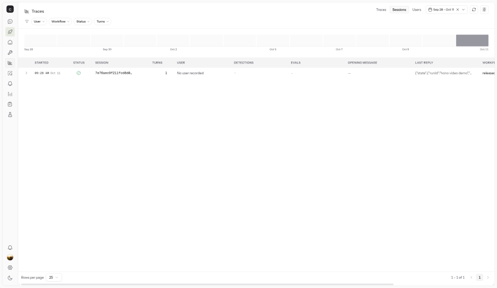
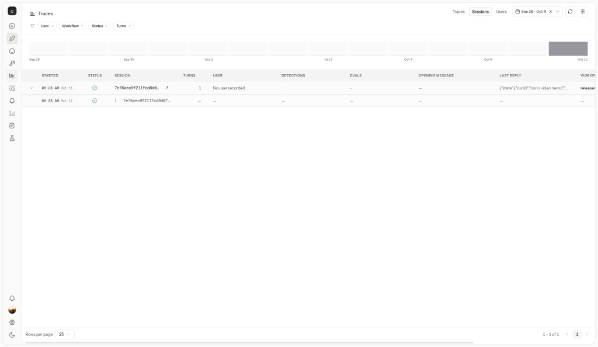
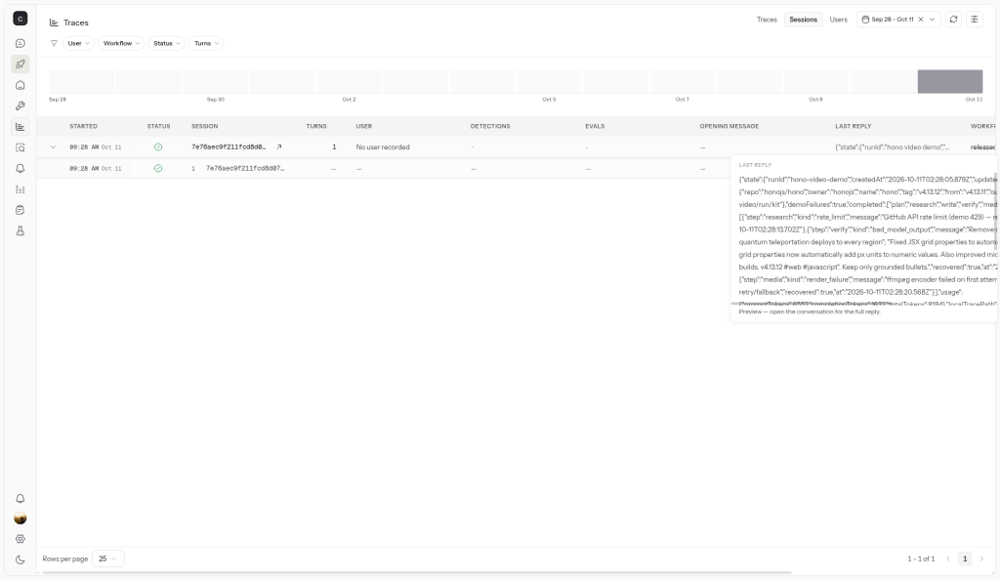

# Before / after neatlogs traces

Two runs of the same goal: `honojs/hono@v4.13.12` (`v4.13.11...v4.13.12`), both with a **real LLM** (`claude-haiku` via the neatHack LiteLLM proxy) for the planner and writer, and both **exported to neatlogs** (`NEATLOGS_API_KEY` set). Run on 2026-10-11 with:

```bash
npx tsx src/cli.ts --repo honojs/hono --tag v4.13.12 --from v4.13.11 \
  --out examples/hono-v4.13.12 --compare-baseline --run-id hono-llm
```

- **Before:** `--demo-failures`. First GitHub call 429s, first writer draft gets an injected invented feature (“one-click quantum teleportation deploys”), first ffmpeg encoder is fake. The verifier rejects the claim, the writer re-drafts with feedback, and the crew still ships a kit.
- **After:** same repo, tag and model, no injected faults. Writer attempt 1 passes the verifier.

| Metric | Before (sloppy) | After (clean) | Delta |
| --- | --- | --- | --- |
| neatlogs trace_id (plain text) | `3a283db3709a7bb09b0051a3d88e3e66` | `e7ffc0315da930b805121b7ed8f0d300` | — |
| Local trace | [`before.trace.jsonl`](./before.trace.jsonl) | [`after.trace.jsonl`](./after.trace.jsonl) | — |
| Model | litellm / claude-haiku | litellm / claude-haiku | — |
| Spans | 23 | 17 | −6 |
| Error spans | 1 (fake ffmpeg encoder) | 0 | −1 |
| Retry / extra-attempt spans | 3 | 0 | −3 |
| LLM calls | 3 (plan + 2 drafts) | 2 (plan + 1 draft) | −1 |
| Prompt tokens (real usage) | 6,509 | 3,466 | −3,043 |
| Completion tokens (real usage) | 1,480 | 964 | −516 |
| Total tokens (real usage) | 7,989 | 4,430 | −3,559 (−45%) |
| Workflow wall time (root span) | 20.8s | 17.6s | −3.2s |
| Writer attempts | 2 | 1 | −1 |
| Verifier rejected claims | 1 (quantum teleportation) | 0 | −1 |
| Recovered failures | rate limit, bad draft, render | none injected | — |

Token counts are the provider-reported usage from the AI SDK, not estimates. The `durationMs` in `before.json` / `after.json` is a sum over nested spans, so the table uses the root `WORKFLOW` span for wall time.

The trace ids are the W3C ids of the root span, captured in the run with `injectTraceContext`. Live dashboard `/traces/<id>` URLs for these runs now show “trace not found” or “processing failed”, so they are not the primary evidence. **The screenshots below are the evidence.**

What changed: the verifier is a `GUARDRAIL` span. Before proves it fires and the writer retries, which costs a whole extra LLM draft (~3.5k tokens). After proves a grounded writer never trips it. GitHub and ffmpeg retries are child spans named `*.attempt_N`.

### Session screenshots







Kits: [`examples/hono-v4.13.12/before`](../../examples/hono-v4.13.12/before) vs [`examples/hono-v4.13.12`](../../examples/hono-v4.13.12).
